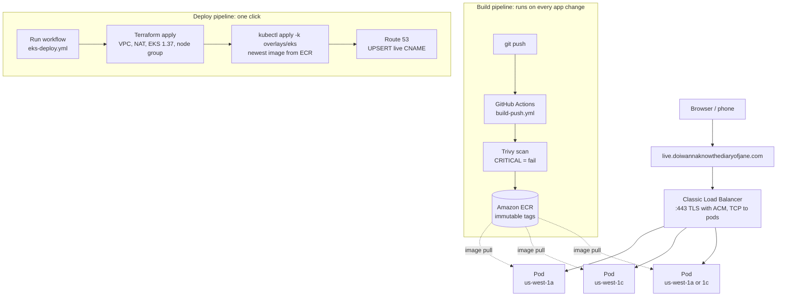

# k8s-aws-portfolio

**A containerized Flask app, scanned and shipped by GitHub Actions, running on a Terraform-built Amazon EKS cluster over HTTPS, with one-click deploy and teardown, even from a phone.**

🔗 **Live demo:** https://live.doiwannaknowthediaryofjane.com
*(The cluster is created on demand and destroyed afterward to keep costs near zero, so the link is only up during demos.)*


---

## What this is

A small Python web app is built into a non-root Docker image, scanned with Trivy, and pushed to Amazon ECR by GitHub Actions using OIDC, with no stored AWS keys anywhere. A second workflow builds the whole AWS environment with Terraform (VPC, NAT gateway, EKS cluster, managed node group), deploys the newest image with Kustomize, and publishes it at an HTTPS address backed by an ACM certificate and Route 53. A third workflow tears everything down in the correct order, and runs nightly as a safety net. Deploying and destroying is one tap in the GitHub mobile app.

**Stack:** Docker · Kubernetes · Amazon EKS · Amazon ECR · Terraform · Kustomize · GitHub Actions (OIDC) · Trivy · ACM · Route 53 · Elastic Load Balancing

---

## Architecture



TLS terminates at the load balancer using a free ACM certificate. Pods run on two t3.medium nodes in private subnets across two Availability Zones and reach ECR through a single NAT gateway. The load balancer itself is created by Kubernetes (from the Service of type `LoadBalancer`), not by Terraform, which matters at teardown time (see below).

---

## The live page

The page shows which pod answered each request, so Kubernetes behavior is visible instead of just described. Browsers get the status page; `curl` gets a one-line text answer (the app checks the `Accept` header).

| Field | Where it comes from |
|---|---|
| Greeting | `GREETING` from a ConfigMap (currently "Live") |
| Version | `APP_VERSION`, baked into the image at build time (the Git commit SHA) |
| Pod name, node name, pod IP | Kubernetes Downward API, injected as environment variables |
| Request bars | The page polls `/api/info` every 1.5 seconds and tallies answers per pod |

Pod IPs show the Availability Zone: `10.34.16–31.x` is us-west-1a and `10.34.32–47.x` is us-west-1c.

**Things to demo on it:**

- **Load balancing:** watch the bars fill across all three pods.
- **Self-healing:** `kubectl delete pod <name>`; the pod disappears from the bars and a replacement appears within seconds.
- **Zero-downtime rolling update:** push a change, run the deploy, and watch the new version appear mid-stream while old pods keep answering (`maxSurge: 1`, `maxUnavailable: 0`).

| Endpoint | Returns |
|---|---|
| `/` | Live status page (browser) or one line of text (curl) |
| `/api/info` | JSON: greeting, version, pod, node, pod IP, time |
| `/health` | Used by readiness and liveness probes |
| `/version` | The running version |


---

## Repository layout

```
.
├── app/app.py                      # Flask app: status page, /api/info, /health, /version
├── Dockerfile, .dockerignore       # python:3.12-slim, non-root user, gunicorn on 8080
├── k8s/                            # Kustomize base (used locally on kind)
│   ├── deployment.yaml             # 3 replicas, probes, Downward API env vars
│   ├── service.yaml                # ClusterIP, port 80 -> 8080
│   ├── configmap.yaml              # GREETING
│   └── kustomization.yaml
├── overlays/eks/kustomization.yaml # ECR image + LoadBalancer Service with ACM on 443
├── infra/
│   ├── bootstrap/                  # Long-lived, near-free: ECR, IAM roles, ACM cert
│   │   ├── main.tf                 # ECR repo + push role
│   │   ├── deploy-role.tf          # Least-privilege EKS deploy role
│   │   └── https.tf                # ACM certificate + DNS validation
│   └── eks/                        # Created per demo: VPC, NAT, EKS, node group, access entries
└── .github/workflows/
    ├── build-push.yml              # Build -> Trivy -> push to ECR
    ├── eks-deploy.yml              # One-click deploy
    └── eks-destroy.yml             # One-click destroy + nightly safety net
```

---

## How to run it

### Locally on kind (free)

```bash
docker build --build-arg APP_VERSION=v3 -t k8s-aws-portfolio:v3 .
kind create cluster --name portfolio
kind load docker-image k8s-aws-portfolio:v3 --name portfolio
kubectl apply -k k8s
kubectl port-forward svc/portfolio-app 8080:80
```

Open http://localhost:8080. Note that `port-forward` connects to a single pod, so the bars will only show one pod locally; use a curl pod inside the cluster to see Service load balancing.

### On AWS

1. **One-time setup** (from a laptop): `terraform apply` in `infra/bootstrap` creates the ECR repo, the two GitHub Actions roles, and the ACM certificate.
2. **Deploy:** GitHub → Actions → **eks-deploy** → **Run workflow** (or `gh workflow run eks-deploy.yml`). About 10–12 minutes from nothing; 2–3 minutes if the cluster already exists.
3. **Destroy:** Actions → **eks-destroy** → **Run workflow**. About 11 minutes. It also runs automatically every night at 1:41 AM Central in case I forget.

Deploy and destroy share a concurrency group, so they can never run at the same time; a second run waits its turn.


---

## Security design

**No stored credentials.** Every workflow authenticates to AWS with OIDC. The deploy role's trust policy uses an exact `StringEquals` match on the token's `sub` claim, built from the repository's and owner's **immutable numeric IDs** and the `main` branch only. I read the real claim in CloudTrail before writing the condition, so a renamed or recreated repo with the same name can't assume the role.

**Least-privilege deploy role.** The role can build a whole EKS environment, so its guardrails matter:

| Guardrail | What it prevents |
|---|---|
| Network actions only in `us-west-1` | Resources spun up in other regions |
| `eks:*` only on the `k8s-portfolio` cluster | Touching any other cluster |
| Create/delete only roles named `k8s-portfolio-*` | Managing unrelated IAM roles |
| Attach only the four EKS managed policies (`iam:PolicyARN` condition) | **Privilege escalation:** creating a role and attaching AdministratorAccess to it |
| `iam:PassRole` only to `eks.amazonaws.com` | Handing project roles to other services |
| Route 53 writes limited to one CNAME | Changing any other DNS record in the zone |
| State access limited to the EKS state key | Reading or overwriting other Terraform state |

**Kubernetes access.** The cluster uses EKS access entries (API authentication mode, no automatic creator admin). My IAM user is cluster admin; the deploy role only gets `AmazonEKSEditPolicy` scoped to the `default` namespace.

**Supply chain.** Trivy scans every image before any AWS step runs, and a CRITICAL finding fails the build. Pull requests build and scan but never push. ECR tags are immutable and scanned on push, and only the newest 10 images are kept.

**Container.** Slim base image, runs as a non-root user, dependencies installed before code is copied, version baked in at build time.

---

## Cost controls

Nothing that bills by the hour stays running. Only near-free pieces persist between demos (ECR, IAM roles, the ACM certificate, the Route 53 zone at $0.50/month, and an S3 state bucket). Everything else (VPC, NAT gateway, EKS control plane, nodes, load balancer) is created by **eks-deploy** and removed by **eks-destroy**.

Safety nets: a nightly scheduled destroy, and an AWS Budget that emails at $8 of a $10 monthly limit. A full weekend of building and testing cost about **$1–2**.

---

## Teardown order and ownership

Terraform didn't create the load balancer (Kubernetes did, from the Service), so `terraform destroy` doesn't know it exists. Destroying the VPC first would either hang on the load balancer's network interfaces or orphan it. The destroy workflow enforces this order:

| Step | Action | Owner |
|---|---|---|
| 1 | Delete the `live` CNAME | Workflow (Route 53) |
| 2 | Delete the Kubernetes Service and wait for the load balancer to disappear | Kubernetes |
| 3 | `terraform destroy` (nodes, cluster, NAT, VPC) | Terraform |

Removing DNS first means the hostname never points at a load balancer that no longer exists.

---

## Troubleshooting highlights

Real problems I hit while building this, and how I worked through them.

| Symptom | Cause | Fix |
|---|---|---|
| Re-running the build job failed at push | ECR's immutable tags rejected the same commit SHA a second time | Added a check-if-tag-exists step. Only `ImageNotFoundException` means "push"; any other error stops the job instead of being treated as a miss |
| New pods stuck in `ImagePullBackOff` | Manifest referenced a tag that didn't exist. `kubectl describe` Events said "pull access denied," which ECR also returns for missing images | Corrected the tag. Old pods kept serving the whole time because the rollout never removes working pods until new ones are ready |
| All pods green, but requests refused in ~7 ms | Service selector `app=portfolio-ap` didn't match pod label `app=portfolio-app`. DNS resolved, but the endpoint slice was empty | Found it by checking endpoint slices, then restored the manifest from Git |
| `terraform destroy` would hang or orphan the load balancer | Kubernetes created the ELB; Terraform never knew about it | Automated the teardown order above: DNS → Service → Terraform |
| First pipeline run failed at `CreateNodegroup` | EKS checks its service-linked role **as the caller**, and the deploy role lacked `iam:GetRole` on it | Added one read-only permission scoped to EKS service-linked roles. Terraform state let the re-run finish in 2.5 minutes |
| Site timed out in Edge but the load balancer was healthy | Edge silently upgraded `http://` to `https://`; nothing listened on 443, so the security group dropped it. A timeout points at the network path | Fixed properly by adding HTTPS with an ACM certificate |
| After adding HTTPS, the page loaded once and then returned 504 | With an HTTP-mode listener, the load balancer held idle connections open and tied up both gunicorn sync workers. Health checks then failed, liveness restarted pods every ~35 s, and readiness emptied the endpoints | Switched the backend protocol to TCP; restarts stopped. The longer-term fix is threaded workers (below) |

---

## What I'd do next

- **AWS Load Balancer Controller with an ALB**, for HTTP-to-HTTPS redirects and smarter routing than the Classic Load Balancer.
- **Threaded gunicorn workers (`gthread`)** so idle connections can never starve the app.
- **Autoscaling:** Horizontal Pod Autoscaler for pods and Cluster Autoscaler or Karpenter for nodes.
- **Pin actions and the Trivy image to exact SHAs** instead of version tags.
- **GitOps with Argo CD**, so the cluster pulls its desired state from Git instead of the pipeline pushing it.

---

## Related

**Project 1 — [terraform-aws-portfolio](https://github.com/YoungMaster009/terraform-aws-portfolio):** a multi-environment AWS web stack (VPC, ALB, Auto Scaling, HTTPS) built with Terraform modules, deployed through GitHub Actions with OIDC, plan checks on pull requests, and a protected main branch.
