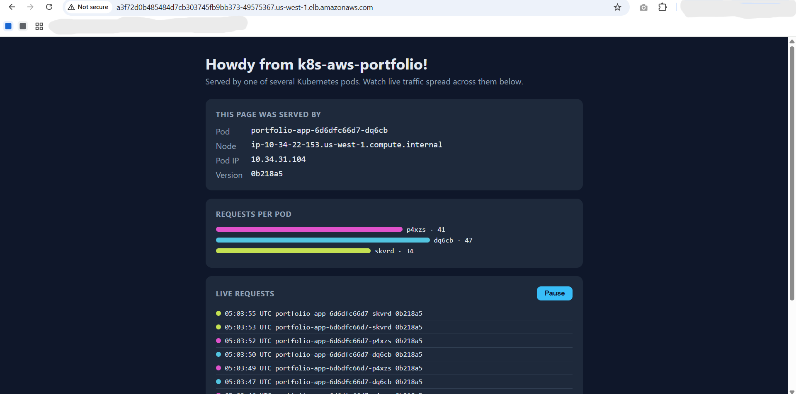
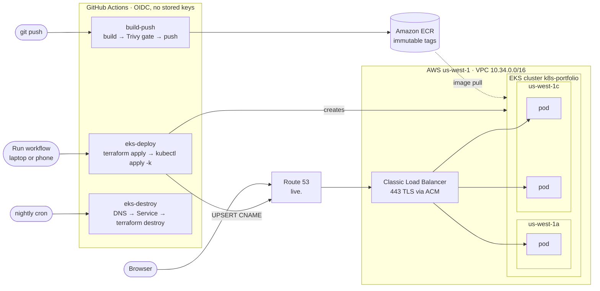
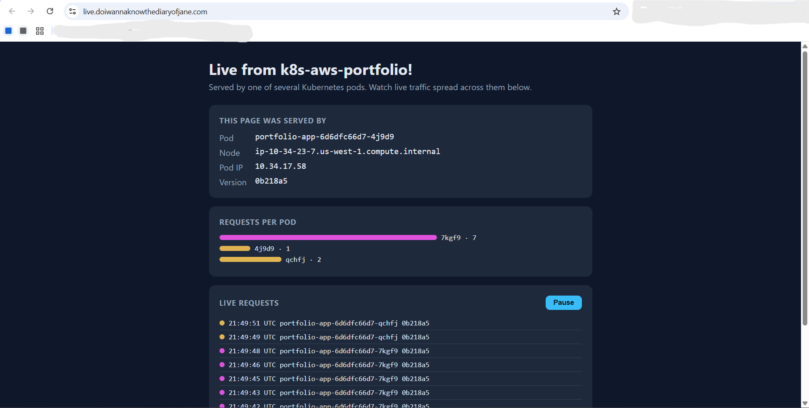
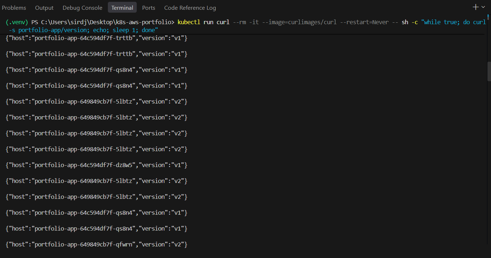

# k8s-aws-portfolio

**A containerized Python app shipped to Amazon EKS by a one-click, keyless pipeline: built, scanned, deployed, served over HTTPS, and torn down again, all from GitHub Actions (even from a phone).**

🔗 **Live demo:** https://live.doiwannaknowthediaryofjane.com
*(The cluster is created on demand to keep costs near zero, so the link only answers while a demo is running. See [Cost controls](#cost-controls).)*



---

## What this is

A small Flask app is containerized with Docker, scanned with Trivy, and pushed to Amazon ECR by GitHub Actions, which authenticates to AWS with OIDC instead of stored keys. A second workflow builds the whole AWS environment with Terraform (VPC, NAT, EKS cluster, node group), deploys the newest image with Kustomize, and publishes it at an HTTPS address backed by an ACM certificate. A third workflow tears everything down in the right order, and runs nightly as a safety net. The page itself shows Kubernetes doing its job: which pod, node and Availability Zone answered each request, live.

**Stack:** Docker · Kubernetes · Amazon EKS · ECR · Terraform · Kustomize · GitHub Actions (OIDC) · Trivy · ACM · Route 53 · kind

## Architecture



## The live page



The page polls `/api/info` every 1.5 seconds. Each request goes through the load balancer and the Kubernetes Service, so a different pod may answer each time.

| Field | Where it comes from |
|---|---|
| Greeting | `GREETING` from a ConfigMap (currently "Live"), so text changes without rebuilding the image |
| Version | The Git commit SHA baked into the image at build time (`APP_VERSION` build arg) |
| Pod, Node, Pod IP | Injected by the Kubernetes Downward API (`metadata.name`, `spec.nodeName`, `status.podIP`) |
| Per-pod bars | A running count of which pod answered each poll |

The node's IP shows the Availability Zone: 10.34.16–31 is us-west-1a, 10.34.32–47 is us-west-1c.

**Things to try during a demo:**

- **Load balancing:** watch the bars fill across all three pods.
- **Self-healing:** `kubectl delete pod <name>`. That pod's bar stops, a new pod name appears within seconds, and the page never goes down.
- **Rolling update:** push a change and re-run `eks-deploy`. A NEW VERSION label appears mid-stream while old and new pods answer side by side (`maxSurge 1`, `maxUnavailable 0`).



`curl` gets a one-line text answer instead of the page (the app checks the `Accept` header), which is handy for loops in a terminal.

## Repository layout

```
app/                    Flask app: status page, /api/info, /health, /version
Dockerfile              python:3.12-slim, non-root user, gunicorn on 8080
k8s/                    Base manifests: Deployment (3 replicas, probes, Downward API),
                        ClusterIP Service, ConfigMap, kustomization.yaml
overlays/eks/           EKS overlay: ECR image, LoadBalancer Service, ACM cert on 443
infra/bootstrap/        Long-lived pieces: ECR repo, push role, deploy role, ACM cert
infra/eks/              Per-demo pieces: VPC, NAT, EKS cluster, node group, access entries
.github/workflows/
  build-push.yml        Build → Trivy → push to ECR on app changes
  eks-deploy.yml        One-click deploy
  eks-destroy.yml       One-click destroy + nightly safety net
```

## How to run

### Locally on kind (free)

```bash
docker build --build-arg APP_VERSION=v3 -t k8s-aws-portfolio:v3 .
kind create cluster --name portfolio
kind load docker-image k8s-aws-portfolio:v3 --name portfolio
kubectl apply -k k8s
kubectl port-forward svc/portfolio-app 8080:80    # open http://localhost:8080
```

Port-forward always connects to a single pod, so the bars only fill evenly on EKS, where traffic goes through the Service.

### On AWS

The long-lived pieces in `infra/bootstrap` are applied once from a laptop. After that, everything runs from GitHub Actions:

| Workflow | Trigger | What it does | Time |
|---|---|---|---|
| `build-push` | Push or PR touching `app/`, `Dockerfile` | Build with the commit SHA as version, Trivy scan (CRITICAL fails the job), skip if the tag already exists, push to ECR. PRs build and scan but never push. | ~1 min |
| `eks-deploy` | Manual | `terraform apply`, select the newest ECR image, `kubectl apply -k overlays/eks`, wait for the rollout, point the `live.` CNAME at the load balancer | 10–12 min fresh, 2–3 min if the cluster exists |
| `eks-destroy` | Manual + nightly at 1:41 AM Central | Remove the DNS record, delete the Service (and its ELB), `terraform destroy` | ~11 min |

```bash
gh workflow run eks-deploy.yml     # or: GitHub app → Actions → eks-deploy → Run workflow
gh workflow run eks-destroy.yml
```

Deploy and destroy share a concurrency group, so they never overlap; a second run waits its turn.

## Security design

- **No stored AWS keys.** GitHub Actions gets short-lived credentials through OIDC. The role trust uses an exact `StringEquals` match on the `sub` claim, built from the repo's and owner's **immutable numeric IDs** and limited to `main`, so a renamed or recreated repo with the same name can't assume it. The claim format was taken from a real CloudTrail event rather than guessed.
- **Least-privilege deploy role.** The role that builds the cluster is fenced in by policy:
  - network actions only in us-west-1, EKS actions only on the `k8s-portfolio` cluster;
  - it can create IAM roles, but only ones named `k8s-portfolio-*`, and can **attach only the four EKS managed policies** to them (`iam:PolicyARN` condition) and pass them only to `eks.amazonaws.com`. Without that guard, a role that can create roles could create itself an admin;
  - Terraform state access limited to this stack's key;
  - Route 53 writes limited to the single `live.` CNAME.
- **Separate push role** scoped to one ECR repository.
- **EKS access entries, not aws-auth.** API authentication mode with no automatic creator admin. My IAM user is cluster admin; the deploy role gets `AmazonEKSEditPolicy` on the `default` namespace only.
- **Scan before push.** Trivy runs before any AWS step, and a CRITICAL finding stops the image from ever reaching ECR.
- **Immutable image tags.** A SHA tag can't be overwritten, so what was scanned is what runs.
- **Non-root container**, slim base image, and a `.dockerignore` that keeps the build context to a few hundred bytes.
- **TLS terminated at the load balancer** with a free ACM certificate validated through Route 53 DNS.

## Cost controls

Nothing that bills by the hour is always on. Only the free or near-free pieces persist between demos (Terraform state bucket, ECR, IAM roles, ACM certificate, the existing Route 53 zone). The cluster, nodes, NAT gateway and load balancer exist only between a deploy and a destroy.

- One-click destroy after every demo, plus a **nightly destroy** in case I forget.
- An AWS Budget emails at 80% of $10 a month.
- A full weekend of building and testing on EKS cost **about $1–2**.

## Teardown order and ownership

The load balancer is created by **Kubernetes** (from the `LoadBalancer` Service), not by Terraform, so Terraform doesn't know it exists. Running `terraform destroy` first would either hang while deleting the VPC (the ELB still holds network interfaces) or leave an orphaned, billing ELB behind. The destroy workflow therefore runs:

1. **Delete the `live.` DNS record**, so the name never points at an address that no longer exists (no dangling DNS).
2. **Delete the Service**, and wait for Kubernetes to remove the ELB it owns.
3. **`terraform destroy`** everything Terraform created.

After a destroy, `aws eks list-clusters`, `aws elb describe-load-balancers` and the Route 53 record lookup all come back empty.

## Troubleshooting highlights

Real problems hit while building this, and how each was found:

| Symptom | Cause | Fix |
|---|---|---|
| A re-run of `build-push` failed after authenticating fine | ECR's immutable tags rejected a duplicate SHA tag | Check whether the tag exists first; push only on `ImageNotFoundException`, stop on any other error |
| New pods stuck in `ImagePullBackOff`, old pods still serving | The image tag didn't exist (the error says "pull access denied" for missing images too) | Read `kubectl describe pod` Events; corrected the tag. The rolling update never removed healthy pods |
| All pods green, but `curl` to the Service was refused in 7 ms | Service selector `app=portfolio-ap` didn't match the pod label `app=portfolio-app`; the endpoint slice was empty | Compared selector to labels, restored the manifest from Git |
| `terraform destroy` would hang or orphan an ELB | Kubernetes, not Terraform, owned the load balancer | Automated the order: DNS → Service → Terraform |
| First pipeline run failed at `CreateNodegroup` | EKS checks its service-linked role *as the caller*; the deploy role lacked `iam:GetRole` on it | Added one read-only, narrowly scoped permission; Terraform state let the re-run finish in 2.5 min |
| Browser timed out on the plain-HTTP URL | Edge silently upgraded to `https://`; nothing listened on 443, so the security group dropped it (a timeout means the network path) | Added a real ACM certificate and a 443 listener |
| After adding HTTPS, the page loaded once, then returned 504 | In HTTP backend mode the ELB held idle connections open, tying up both gunicorn sync workers, so health checks failed and Kubernetes restarted pods every ~35 s | Switched the ELB backend protocol to TCP; restarts stopped |

## What I'd do next

- **AWS Load Balancer Controller with an ALB**, for an HTTP-to-HTTPS redirect (port 80 currently serves plain HTTP) and path-based routing.
- **Threaded gunicorn workers (`gthread`)** so idle connections can never starve the app, regardless of load balancer mode.
- **Autoscaling:** Horizontal Pod Autoscaler with CPU requests, plus Cluster Autoscaler or Karpenter for nodes.
- **Pin GitHub Actions and the Trivy image to exact SHAs** for supply-chain safety.
- **GitOps with Argo CD**, so the cluster pulls its desired state from Git instead of the pipeline pushing it.

## Related

- **Project 1: [terraform-aws-portfolio](https://github.com/YoungMaster009/terraform-aws-portfolio)**: a multi-environment AWS web stack (VPC, ALB, Auto Scaling, WAF, HTTPS) built with Terraform modules, deployed through a protected-branch PR workflow with OIDC.
